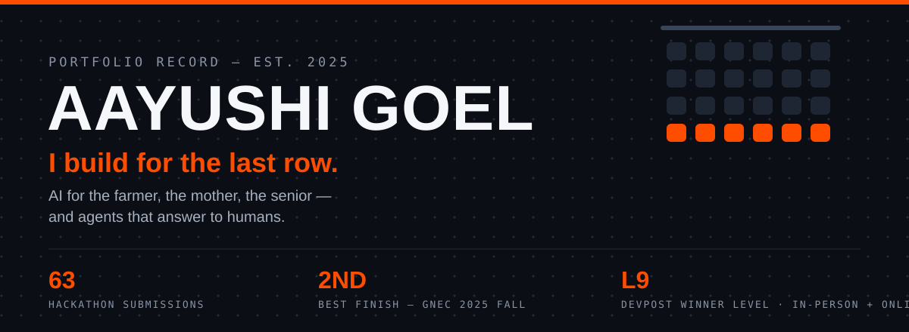
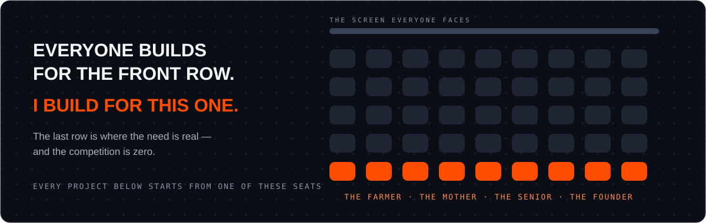
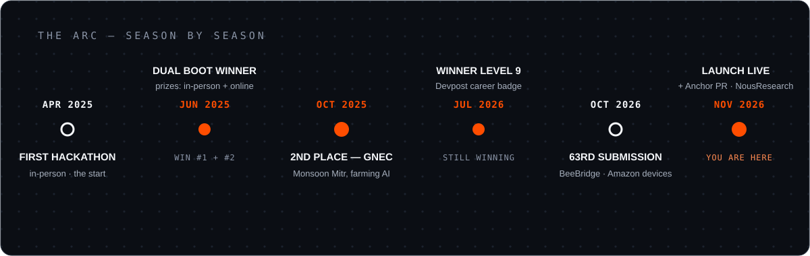

<p align="center">
  <a href="https://devpost.com/aayushigoel73"></a>
</p>

<p align="center">
  
</p>

<p align="center"><strong>Final-year B.Tech CSE · Shobhit University · Meerut, India</strong></p>



| FOR | BUILT |
| --- | --- |
| 🌾 the farmer | **[Monsoon Mitr](https://gnec-hackathon-2025-fall.devpost.com/updates/37238-and-the-winner-is)** — rain, water, crops. Offline, his language. `🏆 2ND · GNEC 2025 FALL` · sibling: **JalRakshak** |
| 📢 the woman who can't read apps | **[Sakhi](https://github.com/Aayu095/Sakhi)** — voice-first AI, no reading, no typing `+ DidiDial` |
| 🌙 the mother awake at 3 AM | **[MaaCheck](https://github.com/Aayu095/MaaCheck)** — WHO pneumonia screening, free, offline, 3 min |
| 🧓 the senior living alone | **BeeBridge** — Bee remembers, Alexa+ answers, Ring watches the door |
| ⚠️ the person one tap from a scam | **[VETO / GarudPay](https://github.com/Aayu095/GarudPay)** — the *Undo Button* for payments: AI holds fraud in escrow |
| 🚀 the founder on launch day | **[Launch](https://github.com/Aayu095/Launch)** — lock what's final, the agent adapts, **nothing ships without your approval** · [LIVE](https://launch-runway.vercel.app) |
| ⚓ everyone whose agent "forgot" | **[Anchor](https://github.com/Aayu095/hermes-anchor)** — pins decisions verbatim through compression · 100 tests, 0 drift · [PR → NousResearch](https://github.com/NousResearch/hermes-agent/pull/152955) |

<p align="center">
  
</p>



```
RULES — 01 the human's decision outranks the model's suggestion — enforce it server-side
        02 if it can't be shown live in 30 seconds, it isn't finished
        03 a guarantee you can't test is a slogan
        04 build for someone specific — "users" is nobody
```

<p align="center">
  🏟️ <a href="https://devpost.com/aayushigoel73"><strong>Full 63-entry record → Devpost</strong></a> · 𝕏 <a href="https://x.com/aayuG_">@aayuG_</a> · 🚀 <a href="https://launch-runway.vercel.app">Latest build, live</a>
</p>

<p align="center"><em>63 in. Still in the arena.</em></p>
